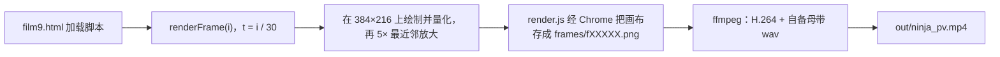

# 周杰伦《忍者》8-bit 像素风 AI PV

粉丝向非商业二创。作者 [Jesse Zhang](https://github.com/JesseZhang97)。最终剪辑是 **v9**，已发布于 B 站：[BV1bHW96cEU7](https://www.bilibili.com/video/BV1bHW96cEU7/)。

本仓库是能把 v9 成片重新渲染出来的源码和素材。故事是一场白日梦：现实（红色连帽衫、居酒屋与和室）滑入忍者幻想（夜色、追逐、竹林近身决斗），再回到现实，最后在日常里醒来。

**音频不包含在仓库里**（版权原因）。渲染前请自行把官方曲目放到 `audio/`，见下方「自备音频」和 `audio/README.md`。

## 技术栈

- **画面**：手写 JavaScript，在 384×216 的 Canvas 上按帧绘制，再以 5 倍最近邻放大到 1920×1080。调色盘是 NINJA-56（在 NINJA-32 上加了 24 色，精灵仍按 32 色索引存储）。角色是手绘像素精灵，分尺寸档，**从不缩放**：中景用 L（约 96 px 高 / 160×120），近景用 XL（约 140 px 高 / 240×180），远景用 M（80×60）；首领另有 K / KL / KXL，对打有 D / DX。`renderFrame(i)` 只由帧号决定画面，`t = i / 30`。
- **出帧**：Node 用 `puppeteer-core` 打开无界面 Chrome，调用 `renderFrame(i)`，把 `#c` 画布存成 PNG。
- **合成**：ffmpeg 把 PNG 编成 H.264（CRF 16、`tune animation`、yuv420p），并叠上按 v9 规格做好的 −14 LUFS 母带 wav。
- **字幕字体**：Fusion Pixel 12px（简体 `FusionPixel`、日文 `FusionPixelJA`）。
- **歌词字幕**：时间轴在 `data.js` 的 `DATA.caps`（由歌词 LRC 生成后写入；本仓库没有 LRC 原文和生成脚本）。`film_main9.js` 按 `t` 叠在画面底部。

## 输出规格

| 项 | 值 |
|---|---|
| 时长 | 159.17 秒（4775 帧 ÷ 30 fps = 159.166… 秒；`DATA.DUR` 为 159.168） |
| 分辨率 / 帧率 | 1920×1080、30 fps |
| 视频 | H.264 High、yuv420p |
| 音频 | AAC-LC、256 kb/s、48 kHz 立体声 |
| 响度 | −14.0 LUFS，LRA 7.4 LU，真峰值 −1.7 dBTP |

## 环境要求

- Node.js ≥ 22.12（`npm ci` 会安装 `puppeteer-core@25.17.0`）
- Google Chrome 或 Chromium（`render.js` / 质检脚本默认 `/usr/bin/google-chrome`，也可用环境变量 `CHROME_PATH`）
- ffmpeg（需 libx264 与 AAC）
- 自备的官方曲目（见下节）

## 自备音频

仓库不包含周杰伦《忍者》的录音。请把文件放到下面的路径（文件名必须一致）：

| 路径 | 格式 | 何时需要 |
|---|---|---|
| `audio/ninja.mp3` | 官方曲目（与 v9 相同的那条音轨，约 159.17 秒） | 还没有母带 wav 时 |
| `audio/ninja_audio_m14c.wav` | 48 kHz 立体声 PCM 母带 | 合成时实际使用这一份 |

只放 mp3 也可以：`./scripts/build.sh` 若发现没有 wav、但有 mp3，会按 v9 的链路生成 wav——先 `+10.85 dB`，再以 192 kHz（相对 48 kHz 的 4 倍过采样）做砖墙限制 `alimiter=limit=0.78:attack=5:release=50:level=false`，然后回到 48 kHz。这条链路与当初的母带一致；叠进 AAC 后成片约为 −14 LUFS、真峰值约 −1.7 dBTP。若 wav 已存在，脚本会直接用它，不再重新生成。

两个文件都不在时，`build.sh` 会报错并指出应放置的路径。详细说明见 `audio/README.md`。

字幕时间（`DATA.caps`）已经对齐 v9 所用的那条音轨：相对 lrclib 时间戳的同步偏移已写进各条 `t`，**不要再额外加减**。若你的文件片头空白或版本不同，字幕可能会偏。

## 快速开始

```bash
# 先放入音频，例如：
#   cp /path/to/ninja.mp3 audio/ninja.mp3
npm ci
./scripts/build.sh
```

生成 `out/ninja_pv.mp4`。`scripts/build.sh` 可读的环境变量：

| 变量 | 默认 | 作用 |
|---|---|---|
| `CHROME_PATH` | 若未设，按 `/usr/bin/google-chrome`、`google-chrome-stable`、`chromium`、`chromium-browser` 依次寻找 | Chrome 可执行文件 |
| `WORKERS` | `7` | 并行渲染的页面数，传给 `render.js --workers` |
| `OUT` | `out/ninja_pv.mp4` | 成片路径 |
| `FRAMES` | `frames` | PNG 输出目录 |

分步也可以：

```bash
npm ci
node render.js --page film9.html --range 0:4774 --workers 7 --out frames
# 若还没有母带：让 build.sh 生成，或按「自备音频」一节的 ffmpeg 链路自行写出 audio/ninja_audio_m14c.wav
ffmpeg -y -framerate 30 -i frames/f%05d.png -i audio/ninja_audio_m14c.wav \
  -c:v libx264 -preset slow -crf 16 -tune animation -pix_fmt yuv420p \
  -c:a aac -b:a 256k -ar 48000 -ac 2 -shortest -movflags +faststart \
  out/ninja_pv.mp4
```

`render.js` 的参数（默认页是本仓库没有的 `index.html`，必须显式传 `--page film9.html`）：

| 参数 | 默认 | 作用 |
|---|---|---|
| `--page` | `index.html` | 要打开的 HTML |
| `--range S:E` | `0:0` | 闭区间帧号，与 `--frames` 二选一 |
| `--frames i,j,…` | （无） | 只渲染列出的帧 |
| `--workers` | `1` | 并行页面数；整片复现须为 `7` |
| `--out` | `frames` | PNG 目录 |
| `--prefix` | `f` | 文件名前缀，写成 `f00000.png` |
| `--skip-existing` | 关 | 已有 PNG 的帧跳过 |
| `--w` / `--h` | `1920` / `1080` | 浏览器视口；影片画布本身固定 1920×1080 |

## 可复现性

要与当初的 v9 逐帧 PNG **字节级一致**，必须 `WORKERS=7`。`render.js` 把帧按 `帧号 % workers` 分给各个页面，同一页会连续画很多帧；页面里会留下一点绘制状态，所以换一个 worker 数（例如 6 或 8）会让大约 17% 的帧对不上。单独用 `--frames` 抽几帧（默认 1 个 worker、页面上没有「前面那些帧」）也有可能和整片 7 worker 的结果有细微差别。

ffmpeg / x264 即使输入 PNG 完全相同，编码结果一般也不是比特级一致（线程和当时的编码参数都会影响码率）。时长、帧数和响度应当一致：159.17 秒、4775 帧、−14.0 LUFS、−1.7 dBTP。

## 目录结构

```
film9.html          成片入口，按下面的顺序加载脚本
core.js             调色、缓动、种子随机、基本形状
pixel3.js           384×216 管线、NINJA-56、量化、像素字、5× 放大
data.js             时间轴：FPS、时长、节拍、段落、字幕 caps、计数章
rig.js              旧版矢量剪纸骨骼（页面仍会加载，v9 角色已改用精灵）
env.js … env6.js    场景绘制（env4 起为 v3 细景，env5/5b 现实与竹林，env6 一点透视）
sprites.js          精灵数据 SPR_DATA（M/L/XL/K/KL/KXL/D/DX/T/H/S/FX）
spr.js              精灵运行时：1:1 贴图，不缩放、不旋转
spr8_edit.js        v8 对精灵网格的行级修改
fx3.js              光影与水等效果，在量化之前叠加
film_a.js / b / c   分幕镜头库，用 F.shot(id, t0, t1, fn, tr) 注册；补丁叠完后共 53 个镜头
film2_patch.js … film9_patch.js   各版补丁：按镜头 id 删掉旧定义再 F.shot 写回，后加载的覆盖先加载的
film_main9.js       renderFrame、转场、标题/字幕/「一二三四」计数章、5× 放大、AUDIT
render.js           无界面 Chrome 出帧
scripts/build.sh    整片渲染 + 编码（缺 wav 且有 mp3 时会生成母带）
tools/film_audit9.js  字幕安全区和脚底–影子质检
fonts/              Fusion Pixel 12px 简体、日文，以及 OFL.txt
audio/README.md     自备音频的路径和格式说明（mp3/wav 不入库）
package.json        依赖与 npm run build / render / audit
```

`film9.html` 的加载顺序：

`core.js` → `pixel3.js` → `data.js` → `rig.js` → `env.js` → `env2.js` → `env3.js` → `sprites.js` → `spr.js` →（`FILM_V2=1`）`film_a.js` → `film_b.js` → `film_c.js` → `film2_patch.js` → `fx3.js` → `env4.js` →（`FILM_V3=1`）`env5.js` → `env5b.js` → `film3_patch.js` →（`FILM_V4=1`）`film4_patch.js` → `env6.js` →（`FILM_V5=1`）`film5_patch.js` →（`FILM_V6=1`）`film6_patch.js` →（`FILM_V7=1`）`film7_patch.js` → `spr8_edit.js` →（`FILM_V8=1`）`film8_patch.js` →（`FILM_V9=1`）`film9_patch.js` → `film_main9.js`

镜头先由 `film_a.js`（第一幕）、`film_b.js`（第二幕）、`film_c.js`（第三幕）登记到 `FILM.SHOTS`。之后每个 `filmN_patch.js` 按 id 过滤掉旧镜头再重新 `F.shot(...)`。因此改某一镜，应改**最后一次定义它的那层补丁**（v9 的锚点、竹林决斗竹竿、禅室烟是 `film9_patch.js`），不要改已经被后层覆盖的早期文件。

## 渲染流程



1. 把官方曲目放到 `audio/ninja.mp3`（或直接放入母带 `audio/ninja_audio_m14c.wav`）。
2. 打开 `film9.html`，按上一节顺序加载。
3. `renderFrame(i)` 用 `t = i / DATA.FPS` 在 `FILM.SHOTS` 里取镜、做转场，再叠标题、字幕、计数章，把低分辨率画布不平滑地放大到 1920×1080。
4. `render.js --page film9.html --range 0:4774 --workers 7 --out frames` 写出 `f00000.png` … `f04774.png`。
5. 若还没有 wav，`build.sh` 会按 v9 链路从 mp3 生成母带。ffmpeg 以 30 fps 读取 PNG，叠 `audio/ninja_audio_m14c.wav`，输出成片。

## 质检

```bash
node tools/film_audit9.js film9.html audit.json 1
```

三个参数依次是：页面路径（默认 `film.html`，这里必须传 `film9.html`）、结果 JSON（默认 `tests/review/audit.json`）、步长（默认 `1`，每隔多少帧检一次）。也可用 `npm run audit`（等价于上面这一行）。脚本同样读取 `CHROME_PATH`。

它会遍历 `round(DATA.DUR * 30)` 帧（步长为 1 时共 4775 帧），检查：

- **字幕安全区**：角色包围盒不得进入字幕框外扩 6 低分辨率像素的区域（横向、纵向皆 6；`set === 'FX'` 的精灵除外）。
- **脚底对影子**：每个角色精灵最低不透明行（刀刃垂得更低时钳到该动画的地面行）与脚下接触阴影中心行的差 `|d| ≤ 1` 艺术像素，且最外侧脚像素落在阴影内。腾空、被遮挡、坐姿/柜台后、画卷、剪影等按规则计为豁免，不记失败。
- 顺带记录字幕出现的帧、镜头表，以及页面报错。

步长可以加大以便快检，例如每隔 30 帧：

```bash
node tools/film_audit9.js film9.html audit.json 30
```

## 修改指南

- **改某一镜**：在最后定义该 id 的补丁里改（v9 相关改 `film9_patch.js`）。新镜头用与补丁里相同的写法：先 `F.SHOTS = F.SHOTS.filter(s => s.id !== id)`，再 `F.shot(id, t0, t1, fn, tr)`。时间单位是秒，`tr` 为转场（默认 `{k:'cut'}`）。
- **改场景**：背景在 `env.js`–`env6.js`（以及 `env5b.js`）。v5 之后的一点透视和接触阴影在 `env6.js`（`E6`）。
- **改精灵**：像素数据在 `sprites.js`（`window.SPR_DATA.sets`）；运行时是 `spr.js` 的 `SPR.draw` / `SPR.frameAt`。只动几行像素时，可仿 `spr8_edit.js` 在加载后改网格，不要缩放精灵。
- **改字幕时间或文案**：编辑 `data.js` 里的 `DATA.caps`（字段：`t`、`end`、`text`、`jp`、`line`）。文件头写着由 `tools_build_data.js` 生成，该脚本不在本仓库，这里直接改 `data.js`。
- **预览单帧或一段**（`t` 秒对应帧号 `t * 30`，例如 16 s → 480、68 s → 2040、90 s → 2700）：

```bash
node render.js --page film9.html --frames 0,480,2040,2700,4530,4774 --out frames
node render.js --page film9.html --range 2040:2070 --out frames
```

加 `--skip-existing` 可跳过已有 PNG，便于接着渲。抽检时默认 `--workers 1`；若要和整片 v9 比特一致，应对整段 `0:4774` 使用 `--workers 7`。

改完后建议再跑 `node tools/film_audit9.js film9.html audit.json 1`。

## 版权说明

音乐为周杰伦《忍者》，版权归原作者及权利方所有。本仓库**不含音频**；请自行准备官方曲目并仅用于个人、非商业的二创渲染，不要把曲目推回本仓库。

源码与画面（脚本、精灵、场景等）由 Jesse Zhang 制作，保留所有权利（All rights reserved）。未另附许可证文件。

Fusion Pixel 字体由 TakWolf 发布，许可为 SIL Open Font License 1.1，见 `fonts/OFL.txt`。
